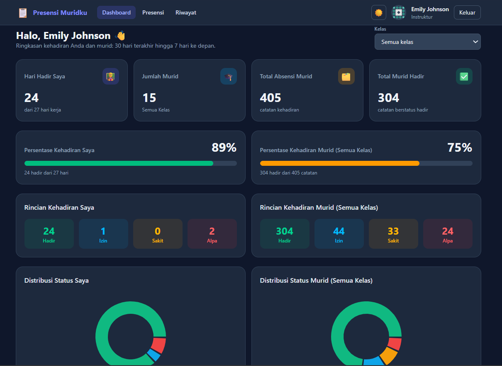
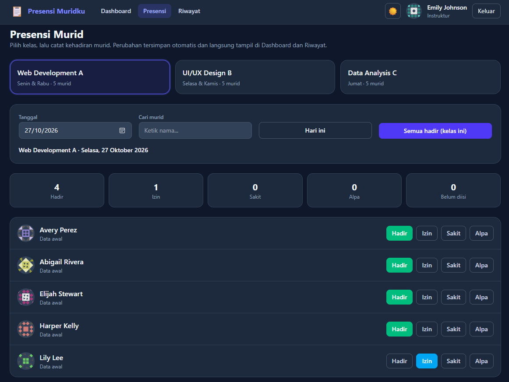
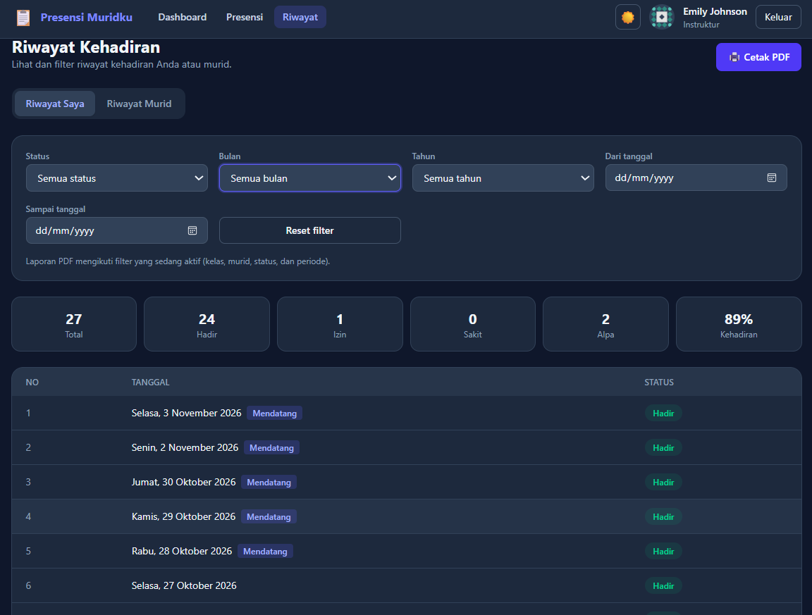
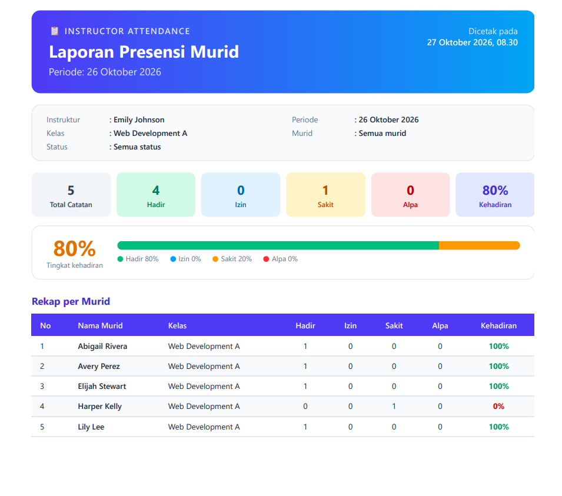

# React + Vite

This template provides a minimal setup to get React working in Vite with HMR and some ESLint rules.

Currently, two official plugins are available:

- [@vitejs/plugin-react](https://github.com/vitejs/vite-plugin-react/blob/main/packages/plugin-react) uses [Oxc](https://oxc.rs)
- [@vitejs/plugin-react-swc](https://github.com/vitejs/vite-plugin-react/blob/main/packages/plugin-react-swc) uses [SWC](https://swc.rs/)

## React Compiler

The React Compiler is not enabled on this template because of its impact on dev & build performances. To add it, see [this documentation](https://react.dev/learn/react-compiler/installation).

## Expanding the ESLint configuration

If you are developing a production application, we recommend using TypeScript with type-aware lint rules enabled. Check out the [TS template](https://github.com/vitejs/vite/tree/main/packages/create-vite/template-react-ts) for information on how to integrate TypeScript and [`typescript-eslint`](https://typescript-eslint.io) in your project.


# 📋 Instructor Attendance

Web app absensi untuk instruktur. Instruktur dapat mencatat dan memantau kehadiran
dirinya sendiri maupun murid dari beberapa kelas, lengkap dengan persentase
kehadiran, grafik, dan riwayat yang bisa difilter.

## Halaman Dashboard

## Halaman Presensi

## Halaman Riwayat

## Halaman Cetak PDF


## Daftar Isi

- [Fitur](#fitur)
- [Teknologi](#teknologi)
- [Cara Menjalankan](#cara-menjalankan)
- [Akun Demo](#akun-demo)
- [Panduan Penggunaan](#panduan-penggunaan)
- [Sumber Data](#sumber-data)
- [Library Tambahan](#library-tambahan)
- [Struktur Folder](#struktur-folder)
- [Keputusan Teknis](#keputusan-teknis)
- [Keterbatasan dan Pengembangan Lanjutan](#keterbatasan-dan-pengembangan-lanjutan)

## Fitur

**Login**
- Login dengan email dan password (validasi sederhana terhadap data DummyJSON)
- **Ingat saya**: email tersimpan dan terisi otomatis setelah logout
- Halaman dashboard dilindungi: pengguna yang belum login diarahkan ke halaman login

**Dashboard**
- Kartu ringkasan: kehadiran saya, jumlah murid, total absensi murid, total murid hadir
- Persentase kehadiran pribadi dan murid (warna bar mengikuti tingkat kehadiran)
- Rincian status: Hadir, Izin, Sakit, Alpa
- Grafik distribusi status, tren kehadiran harian, dan perbandingan antar kelas
- Filter per kelas

**Presensi Murid**
- Pilih kelas dan tanggal, lalu catat status tiap murid dengan satu klik
- Tombol "Semua hadir (kelas ini)", pencarian murid, dan batalkan input
- Perubahan langsung tampil di Dashboard dan Riwayat

**Riwayat Kehadiran**
- Tab **Riwayat Saya** dan **Riwayat Murid**
- Filter: kelas, murid, status, **bulan, tahun**, dan rentang tanggal
  (bulan/tahun tersinkron dengan rentang tanggal)
- Ringkasan angka mengikuti hasil filter, plus paginasi
- **Cetak PDF**: laporan berwarna siap cetak (kop, ringkasan, rekap per murid,
  rincian, dan kolom tanda tangan) yang mengikuti filter aktif

**Lainnya**
- Mode terang dan gelap (mengikuti pengaturan perangkat, pilihan diingat)
- Tampilan responsif untuk desktop dan mobile
- Penanganan loading, error (dengan tombol "Coba lagi"), data kosong, dan data tidak valid

## Teknologi

| Kebutuhan | Yang dipakai |
|---|---|
| Framework | React (JavaScript) + Vite |
| REST API | Fetch API |
| Styling | Tailwind CSS |
| Version control | Git |
| Data | DummyJSON + dataset lokal |
| Cetak PDF | `window.print()` + varian `print:` Tailwind (tanpa library tambahan) |

## Cara Menjalankan

### 1. Prasyarat

Pasang **Node.js versi LTS** dari https://nodejs.org (disarankan 20.19 atau lebih baru).
Cek di terminal:

```bash
node -v
npm -v
```

Kalau keduanya menampilkan nomor versi, lanjut ke langkah berikutnya.

### 2. Unduh project

```bash
git clone ISI_URL_REPOSITORY
cd instructor-attendance
```

> Tidak memakai Git? Unduh sebagai ZIP, ekstrak, lalu buka terminal di dalam folder
> `instructor-attendance`.

### 3. Pasang dependency

```bash
npm install
```

### 4. Jalankan aplikasi

```bash
npm run dev
```

Buka alamat yang muncul di terminal (biasanya **http://localhost:5173**), lalu login
dengan [akun demo](#akun-demo).

> Aplikasi membutuhkan **koneksi internet** karena data pengguna diambil dari DummyJSON.

### Perintah lain

| Perintah | Fungsi |
|---|---|
| `npm run dev` | Menjalankan mode pengembangan |
| `npm run build` | Membuat versi produksi di folder `dist/` |
| `npm run preview` | Menjalankan hasil build secara lokal |
| `npm run lint` | Memeriksa kualitas kode |

## Akun Demo

Akun instruktur diambil dari DummyJSON:

| Email | Password |
|---|---|
| `emily.johnson@x.dummyjson.com` | `emilyspass` |

Daftar instruktur lain (user dengan role `admin`) bisa dilihat di
https://dummyjson.com/users/filter?key=role&value=admin

## Panduan Penggunaan

1. **Login** memakai akun demo. Centang **Ingat saya** agar email terisi otomatis lain kali.
2. **Dashboard** menampilkan ringkasan. Gunakan dropdown **Kelas** untuk melihat satu kelas saja.
3. Buka menu **Presensi**, pilih kelas dan tanggal, lalu klik status tiap murid
   (Hadir, Izin, Sakit, Alpa).
4. Kembali ke **Dashboard** atau buka **Riwayat**. Angka, grafik, dan tabel sudah
   mengikuti data terbaru. Catatan hasil input manual diberi label **Manual**.
5. Di **Riwayat**, gabungkan filter kelas, murid, status, dan tanggal untuk
   mempersempit data. Klik **Reset filter** untuk mengembalikan semua data.
6. Untuk mencetak laporan, buka **Riwayat**, atur filter (misalnya pilih **Bulan** dan
**Tahun**), lalu klik **🖨️ Cetak PDF**. Di dialog cetak browser:

| Pengaturan | Pilihan |
|---|---|
| Destination | **Save as PDF** |
| Paper size | A4, Portrait |
| Headers and footers | Nonaktif |
| Background graphics | **Aktif** (agar warna ikut tercetak) |
6. Ganti tema dengan tombol 🌙 / ☀️ di pojok atas.

## Sumber Data

| Data | Sumber |
|---|---|
| Instruktur dan login | DummyJSON: `GET /users/filter?key=role&value=admin` |
| Murid (nama, email, foto) | DummyJSON: `GET /users/filter?key=role&value=user` (15 murid pertama) |
| Kelas | Dataset lokal `src/data/classes.js` (3 kelas, murid dibagi bergiliran) |
| Data absensi awal | Dataset lokal `src/data/attendance.js` |
| Input presensi manual | `localStorage` browser |

DummyJSON tidak menyediakan data absensi maupun kelas, sehingga dilengkapi dataset lokal
sesuai ketentuan tugas (tanpa back-end sendiri).

**Tentang data absensi awal:** berisi 30 hari terakhir hingga **7 hari ke depan** (hari
kerja saja) sebagai data demo. Status tiap tanggal dibuat secara *deterministik*
(hash dari ID dan tanggal), jadi angkanya selalu sama setiap aplikasi dibuka. Input
manual **menimpa** data awal pada murid dan tanggal yang sama.

## Library Tambahan

| Library | Alasan |
|---|---|
| `react-router-dom` | Navigasi antar halaman dan proteksi halaman (protected route) |
| `recharts` | Grafik donat, area, dan batang yang responsif |
| `tailwindcss` | Styling cepat dan konsisten, termasuk dukungan dark mode |

## Struktur Folder
```
src/
├── components/   # Komponen UI yang dipakai ulang
│                 #   Navbar, StatCard, PercentageCard, StatusBreakdown, StatusBadge,
│                 #   Avatar, HistoryTable, PrintReport, grafik,
│                 #   LoadingState, ErrorState, EmptyState
├── context/      # State global: AuthContext, ThemeContext, AttendanceContext
├── data/         # Dataset lokal: absensi dan kelas
├── hooks/        # useAttendanceData: pengambilan dan penggabungan data
├── pages/        # Halaman: Login, Dashboard, TakeAttendance, History
├── services/     # Pemanggilan REST API DummyJSON
└── utils/        # Logika murni (tanpa UI):
                  #   stats (statistik), filters (filter), validators (validasi),
                  #   dates (tanggal & periode), report (penyusun laporan),
                  #   print (cetak), chartTheme (warna grafik)
```

## Keputusan Teknis

- **Logika dipisah dari UI.** Komponen hanya menampilkan data. Perhitungan statistik
  (`utils/stats.js`), filter (`utils/filters.js`), validasi (`utils/validators.js`),
  dan pemanggilan API (`services/api.js`) berada di luar komponen.
- **Satu sumber data.** Dashboard, Presensi, dan Riwayat memakai hook
  `useAttendanceData`, sehingga ketiganya selalu sinkron.
- **Komponen reusable.** Kartu, badge, tabel, grafik, serta state loading, error, dan
  kosong dipakai di beberapa halaman.
- **Keamanan "Ingat saya".** Hanya **email** yang disimpan. Password tidak pernah
  disimpan aplikasi; pengisian otomatis ditangani pengelola password browser.
- **Dark mode.** Memakai class `dark` pada tag `<html>`. Preferensi disimpan, dan
  script kecil di `index.html` mencegah layar berkedip saat dimuat ulang.
- **Cetak PDF tanpa library tambahan.** Memakai `window.print()` dan komponen
  `PrintReport` yang hanya tampil saat mencetak. Pengguna memilih "Simpan sebagai
  PDF" di dialog cetak browser, dan nama file otomatis mengikuti periode laporan.
  Logika penyusunan laporan dipisah di `utils/report.js`.

## Keterbatasan dan Pengembangan Lanjutan

**Keterbatasan :**
- Autentikasi hanya simulasi (tanpa token dan tanpa back-end).
- Input presensi manual tersimpan di browser (`localStorage`), jadi tidak terbawa ke
  perangkat atau browser lain.
- Status pada tanggal mendatang adalah data simulasi agar fitur terlihat penuh.
- Pembagian murid ke kelas bersifat dummy.
- Cetak PDF memakai dialog cetak browser, sehingga pengguna perlu memilih
  "Save as PDF" secara manual.

**Pengembangan lanjutan:**
- Autentikasi sungguhan (JWT) dan penyimpanan ke database
- Ekspor riwayat ke CSV atau PDF
- Check-in presensi untuk instruktur
- Catatan keterangan pada izin atau sakit
- Pengujian otomatis untuk fungsi di `utils/`